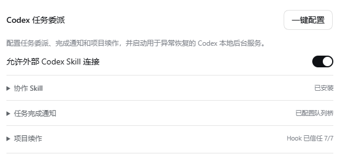
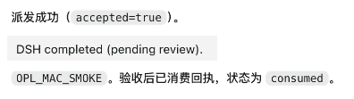

# 在 Codex 里把任务交给 DSH

你可以留在一个 Codex 聊天里，把项目中的一部分工作交给 DSH 用指定模型执行，再让 Codex 检查结果。例如，让 DeepSeek 查日志，让另一个模型审查修复，最后回到同一个聊天看结论。第一次建议从读取一个文件开始，这样你能亲自核对结果。

## 第一次配置

1. 在同一台电脑上装好并打开 Codex，再[安装 OPL DSH](../README.md#下载安装)。打开 **DeepSeek Harness**，连接你有权使用的模型来源，先在 DSH 里成功发一条消息。已有可用的 DeepSeek + DSH 组合就够了。其他组合见[模型与执行组合](model-harness-guide.md)。
2. 打开 **DSH 设置 → 协作与自动化 → Codex 任务委派**，点 **一键配置**。Windows 和 Apple Silicon Mac 的入口相同。已经配过一部分也可以点。它会检查协作 Skill、自动启动 DSH、完成通知和项目续作所需的本地后台服务。看按钮下方的结果，部分成功时会写明还缺哪一步。
3. 对照下图，先确认 **允许外部 Codex Skill 连接** 已开启、**协作 Skill** 显示「已安装」、**任务完成通知** 显示「已配置队列桥」。如果要启用项目续作，按提示前往 **Codex 设置 → 钩子** 确认对应的 OPL 项，再回来点 **刷新状态**。普通任务回执只需要通知桥。
4. 在 **Codex** 打开要工作的项目，在该项目下开始聊天。如果安装前打开的聊天找不到 Skill，开一个新聊天再试。

## 发出第一个任务，亲自核对结果

在一个测试目录里新建 `input.txt`，自己写一行文字并保存。用 Codex 打开这个目录，复制下面的提示词。保留文件名，把文件里的文字留作验收答案。如果你使用其他组合，把提示词中的「DeepSeek + DSH」换成已在 DSH 跑通的组合名。

> 使用 $opl-dsh-official，把一个任务交给 DSH。使用当前项目目录和已就绪的 DeepSeek + DSH 组合。请它实际调用终端读取 input.txt 并返回原文，全程只读。只派一次。派发后告诉我 DSH 会话 ID，结束本轮。完成通知回来后，请检查原会话的终端输出，对照文件验收，在这个聊天里告诉我结果。组合不可用时告诉我原因。

| 原 Codex 聊天里看到什么 | 接下来做什么 |
| --- | --- |
| Codex 返回 DSH 会话 ID，有时还会显示 `accepted=true` | 任务已被接收。想看实时进展，可以在 DSH 打开对应会话。 |
| 原聊天自动收到 `DSH completed (pending review)` | DSH 已完成，等待 Codex 验收。通知附带的命令由 Skill 处理。若收到 `failed`，说明通知已送达，接下来查任务本身的错误。 |
| Codex 汇报工具实际执行的命令、文件原文及核对结果 | 和你写入的文字对照。看到真实工具记录并且内容一致，这次试用就成功了。回执显示 `consumed` 表示 Codex 已处理这条通知。 |

下面截取了一次 Mac 实测中同一 Codex 聊天的三个片段。第一次派发已接收，随后自动收到通知，最后回执在验收后被消费。

要验证**自动启动**，正常退出空闲的 DSH，更换文件中的文字，再从 Codex 派一次。要继续同一份工作，可以说「继续刚才的 DSH 会话，根据日志指出最早出错的文件和行号」。

## 单次、并行和项目续作怎么选

| 想完成的工作 | 可以怎样告诉 Codex |
| --- | --- |
| 一次查询或一次修改 | “让 DSH 用指定组合检查这个文件。把改动范围限制在这里，完成后回到这个聊天验收。” |
| 并行检查 | “派两个会话并行，一路查前端，一路查服务端，都只读。收到结果后核对两边的证据。”允许写入时，写清各自负责的文件和谁负责集成。 |
| 需要跨轮次推进的项目 | “登记为可续作项目。先复现，再修复，再验收。记录每一步的验收条件和检查点，主审中断时从检查点继续，需要我批准时暂停。” |

任务完成通知负责把某个任务的结果送回原聊天。**项目续作**另外记录整个项目还有哪些步骤、主审验收到哪里。它只处理明确登记的项目。普通 DSH 自建聊天和 Codex 自带的子代理沿用各自的流程。[项目续作详解](project-coordinator.md)

## 设置选项与常见问题

| 选项 | 用途 |
| --- | --- |
| 允许外部 Codex Skill 连接 | 委派的总开关。只在 DSH 聊天时可以关闭。 |
| 协作 Skill | 让 Codex 知道怎样派发、查原会话和验收。缺失时点「安装 Skill」，已装可点「更新 / 修复 Skill」。 |
| Codex 派发任务时自动启动 DSH | 开启后，DSH 已退出时可以被派发动作拉起。关闭后先手动打开 DSH。 |
| 任务完成通知 | 选择「Codex 队列桥」可自动通知原聊天。选「不主动唤醒」也能派发，之后主动告诉 Codex「查刚才的原任务」。 |
| 运行环境、队列桥可执行文件、WSL 发行版 | 通常由一键配置查找。本机模式使用支持队列命令的 Codex，确实从 WSL 使用时才指定发行版。手动更改后点「保存通知设置」并重新打开 OPL DSH。 |
| 项目续作 | 安装或移除 Hook、刷新信任状态。主审异常退出后要自动接手，还需要受支持的 Codex 本地后台服务。以一键配置的结果为准。移除 Hook 后仍可收普通回执。 |
| DSH 内协作 | 页面上方的自动唤回验收、最多要求修改次数和角色默认组合，管理的是 **DSH 内发起的协作**。可另外设置。[跨 Harness 团队](cross-harness-team.md) |

**任务已经在 DSH 完成，原聊天没有动静**：让 Codex 查询刚才的 DSH 会话，无需重派。回设置查看「任务完成通知」。若一键配置提示未找到支持通知的 Codex，先更新 Codex，再点一次配置。

**任务卡在等待批准或等待输入**：打开对应 DSH 会话，查看具体工具请求，决定是否批准或补充答案，然后继续原任务。

**能收到回执，但中断后没有恢复项目**：确认项目已登记，检查「项目续作」的 Hook 信任状态，再看一键配置是否确认后台服务可接手。普通派发成功只验证了派发和通知这两步。
