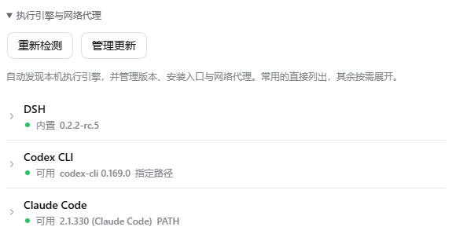
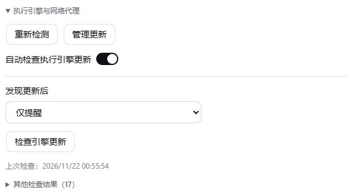

# 让模型通过对应的官方执行引擎工作

想在 DSH 里用 GPT 调工具，可以选择 **OPL Gateway 的 GPT + Codex CLI**。模型和额度来自你的 Gateway 分组，在电脑上执行任务的是 Codex CLI，对话留在 DSH。这个搭配在界面中叫作**执行组合**。同理，Claude 可以配 Claude Code，Gemini 可以配 Antigravity CLI。只需配置自己打算用的引擎。

## 从空白环境跑通第一个组合

下面用 **GPT + Codex CLI** 举例。需要 Windows x64 或 Apple Silicon Mac，以及有相应 GPT 分组权限的 OPL Gateway 账号。若你只有 DeepSeek 分组，可以先用 **DeepSeek + DSH** 走一遍同样的流程，跳过安装外部引擎这一步。

1. **连接模型来源。** 安装并打开 DeepSeek Harness，首次设置选 OPL Gateway，或稍后在 **设置 → OPL Gateway** 登录。分组由账号权限决定，在 OPL Gateway 页面即可直接管理分组激活开关与可用模型。[安装入口](../README.md#下载安装)
2. **安装或就地切换执行引擎。** 可以直接在对话输入框的模型菜单里选好模型，再打开「执行引擎」面板查看当前推荐引擎：若未安装可在此一键安装、先临时切换为 DSH 等已安装的兼容引擎，或前往 **设置 → 执行引擎与协作** 检测本机可执行文件、管理更新与代理；也可在同一处添加「自定义标准 ACP 引擎」。
3. **可选的默认组合调整。** 若想调整某模型的默认引擎或从推荐列表开启备选组合，可在 **设置 → 执行引擎与协作** 展开 **自定义默认规则与快捷预设**（或在聊天框「执行引擎」面板切换后直接点「设为该模型默认」）。
4. **发一次带工具的请求。** 在一个测试工作区放一份有内容的 `input.txt`。新建 DSH 对话，打开输入框的模型菜单，在「模型」中选 OPL Gateway 对应的 GPT，在「执行引擎」确认 **Codex CLI**，发送：“请用终端读出本工作区 input.txt 的第一行，原样返回。”选择满足任务所需的会话权限。
5. **核对结果。** 在对话里展开工具记录，确认实际读取了这份文件，并和文件第一行对照。能看到工具记录和正确内容，才验证了这个组合在你的电脑上能工作。以后可以直接在输入框选择它，也可以[让 Codex 派发给它](codex-task-delegation.md)。

## 换一种模型来源时，哪些步骤会变

| 模型来源         | 去哪里配置                                                                                                                      | 如何选择引擎                                                                                                                                          |
| ---------------- | ------------------------------------------------------------------------------------------------------------------------------- | ----------------------------------------------------------------------------------------------------------------------------------------------------- |
| OPL Gateway      | 「设置 → OPL Gateway」一站式完成登录、分组启用与勾选模型；需要维护自定义模型字段时在同处展开「手动配置模型」。 | 例如 GPT 配 Codex CLI，Claude 配 Claude Code，Gemini 默认配 Antigravity CLI，DeepSeek 默认 DSH；可在聊天框「执行引擎」随时切换其他兼容引擎。 |
| OFM 免费模型     | 在「OFM 模型服务」查看渠道和模型可用状态，再到「设置 → 执行引擎与协作 → 自定义默认规则与快捷预设 → OFM 新模型发现」看推荐。 | 以具体渠道和完整模型名为准。例如 EAC Big Pickle 推荐 OpenCode，经 OFM 转发。同名的其他渠道可以走不同线路。见[按渠道的适配表](harness-adaptation.md)。 |
| Google 账号      | 在「模型供应商 → Google 账号（Antigravity CLI）→ 编辑」登录，在浏览器完成授权。已在官方 CLI 登录的用户可直接刷新。              | 模型列表来自当前账号，使用 Antigravity CLI 和 Google 账号额度。如果发送时提示许可错误 `#3501`，请检查当前 Google 账号的 Antigravity 使用资格。同名的 OPL Gateway 模型仍使用网关额度。                                                |
| MiniMax 官方账号 | 在「模型供应商 → MiniMax 官方账号（mcode）→ 编辑」启用集成，选择中国站或国际站，在官方网页完成授权。                            | 使用 MiniMax Code。即使两区都已登录，会话也只使用当前选定的地区。国际站从中国大陆访问时需使用可访问该站的网络。[MiniMax 设置详解](minimax-code.md)    |

**官配、推荐和可运行**分别回答不同的问题。官配表示模型与其对应的官方引擎有明确搭配。推荐还考虑渠道允许的调用方式。真正运行还需要账号有权限、渠道在线、本机程序可用。看到「仅可手动尝试」表示尚无自动推荐。可尝试的引擎以聊天框「执行引擎」或手动添加时实际列出的选项为准。

## 「执行引擎与协作」里的选项怎么用

| 入口                    | 用法                                                                                                                                                                                                                                                                                            |
| ----------------------- | ----------------------------------------------------------------------------------------------------------------------------------------------------------------------------------------------------------------------------------------------------------------------------------------------- |
| 顶部本机引擎清单        | 「重新检测」查本机程序；展开单个引擎可看路径、版本、一键安装/更新入口、可执行文件路径配置及单引擎代理设置；底部支持 **添加自定义标准 ACP 引擎**。 |
| 自定义默认规则与快捷预设（折叠） | 包含 **OFM 新模型发现**、**启用与添加组合**（支持按引擎批选或移除自定义条目）、**手动添加组合** 与 **已启用的组合**（可设置某模型默认组合或停用）。 |
| 运行超时与队列限制（折叠） | 开启「启用 OPL 进展超时」，配置首次进展前与连续无进展等待上限，以及会话并发与排队限制。保存后对后续轮次生效。 |
| 跨引擎协作与外部 Codex 委派（折叠） | 配置 DSH 内协作自动验收与角色默认组合，以及外部 Codex 任务委派一键配置、Skill 维护、完成通知队列桥和项目续作 hooks。 |

## 更新引擎

打开 **设置 → 执行引擎与协作 → 管理更新**。点击「检查引擎更新」查询有新版的引擎，勾选后点「更新所选」。可更新的项目支持并行安装，正在使用的引擎等空闲后再更新。「本次更新」显示已处理的数量和各项结果。展开「其他检查结果」可查看其余引擎的状态和原因。

- 打开 **自动检查执行引擎更新**，选 **仅提醒**，就可以从左下角的更新提示进入设置，自己决定何时装。
- 选 **自动安装更新**，可交由 OPL 更新的引擎会在合适时机安装。想完全手动管理，可关闭自动检查。
- 显示 **单独管理** 时按该行说明操作。例如 macOS 上随桌面应用提供的 Codex CLI 通过桌面应用更新，固定版本或自定义入口也可能由原安装渠道维护。「重新检测」可用于更新后核对当前实际运行的版本。

## 列表里看得到，为什么用不了

| 现象                                 | 从哪里查                                                                                                                       |
| ------------------------------------ | ------------------------------------------------------------------------------------------------------------------------------ |
| 在「模型供应商」找不到模型           | 检查账号分组、渠道目录及是否已保存选择。仅安装本机 CLI 不会增加账号分组权限。                                                  |
| 设置里有模型，输入框里没有           | 先看「已启用的组合」是否有这条记录、状态是否可用，再看执行引擎的路径与检测结果。                                               |
| 提示缺少权限、模型未广告或版本未检测 | 根据具体报错检查会话权限、完整模型 ID、引擎版本和启动入口。更换模型时同时核对右侧来源，尤其是 OFM 的同名模型。                 |
| 返回 429、502 或长时间无进展         | 先核对是哪一个来源、哪一个模型、哪个引擎。429 常与额度或频率有关，502 需结合网关和上游日志定位。报错保留原渠道，方便继续排查。 |
