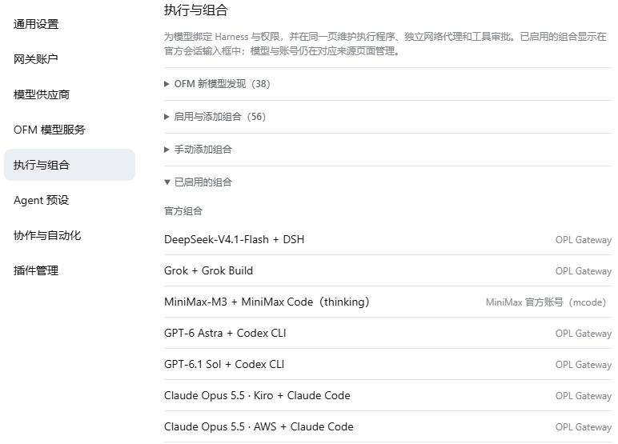

# 让模型通过对应的官方执行引擎工作

想在 DSH 里用 GPT 调工具，可以选择 **OPL Gateway 的 GPT + Codex CLI**。模型和额度来自你的 Gateway 分组，在电脑上执行任务的是 Codex CLI，对话留在 DSH。这个搭配在界面中叫作**执行组合**。同理，Claude 可以配 Claude Code，Gemini 可以配 Antigravity CLI。只需配置自己打算用的引擎。

## 从空白环境跑通第一个组合

下面用 **GPT + Codex CLI** 举例。需要 Windows x64 或 Apple Silicon Mac，以及有相应 GPT 分组权限的 OPL Gateway 账号。若你只有 DeepSeek 分组，可以先用 **DeepSeek + DSH** 走一遍同样的流程，跳过安装外部引擎这一步。

1. **连接模型来源。** 安装并打开 DeepSeek Harness，首次设置选 OPL Gateway，或稍后在 **设置 → 网关账户** 登录。分组由账号权限决定。进入 **模型供应商 → OPL Gateway → 选择模型**，切到相应分组，勾选目录中可用的 GPT 模型并保存。[安装入口](../README.md#下载安装)
2. **安装执行引擎。** 进 **设置 → 执行与组合 → 执行引擎与网络代理**，展开 **Codex CLI**。已有安装先点「重新检测」，查看实际启动入口和版本。尚未安装时用该引擎提供的安装按钮。如果这台电脑上只有官方说明链接，就按链接安装，再回来重新检测。引擎一栏显示可用后继续。
3. **启用组合。** 在同一页展开 **启用与添加组合**，搜索上一步选的模型，在 Codex CLI 组勾选需要的条目，点 **保存选择**。若已出现在 **已启用的组合**，可以直接用。组名旁的复选框可批量选择，保存前看清本次勾选的范围。
4. **发一次带工具的请求。** 在一个测试工作区放一份有内容的 `input.txt`。新建 DSH 对话，打开输入框的模型菜单，在「模型」中选 OPL Gateway 对应的 GPT，再在「执行引擎」确认或选择 **Codex CLI**，发送：“请用终端读出本工作区 input.txt 的第一行，原样返回。”选择满足任务所需的会话权限。
5. **核对结果。** 在对话里展开工具记录，确认实际读取了这份文件，并和文件第一行对照。能看到工具记录和正确内容，才验证了这个组合在你的电脑上能工作。以后可以直接在输入框选择它，也可以[让 Codex 派发给它](codex-task-delegation.md)。

## 换一种模型来源时，哪些步骤会变

| 模型来源         | 去哪里配置                                                                                                                      | 如何选择引擎                                                                                                                                          |
| ---------------- | ------------------------------------------------------------------------------------------------------------------------------- | ----------------------------------------------------------------------------------------------------------------------------------------------------- |
| OPL Gateway      | 「网关账户」登录，在「模型供应商 → OPL Gateway」选择该账号能用的模型。需要维护模型 ID、名称或接口协议时再展开「手动配置模型」。 | 例如 GPT 配 Codex CLI，Claude 配 Claude Code，Gemini 默认配 Antigravity CLI。不同分组即使提供同名模型，也各用各自的凭据。                             |
| OFM 免费模型     | 在「OFM 模型服务」查看渠道和模型可用状态，再到「执行与组合 → OFM 新模型发现」看推荐。                                           | 以具体渠道和完整模型名为准。例如 EAC Big Pickle 推荐 OpenCode，经 OFM 转发。同名的其他渠道可以走不同线路。见[按渠道的适配表](harness-adaptation.md)。 |
| Google 账号      | 在「模型供应商 → Google 账号（Antigravity CLI）→ 编辑」登录，在浏览器完成授权。已在官方 CLI 登录的用户可直接刷新。              | 模型列表来自当前账号，使用 Antigravity CLI 和 Google 账号额度。如果发送时提示许可错误 `#3501`，请检查当前 Google 账号的 Antigravity 使用资格。同名的 OPL Gateway 模型仍使用网关额度。                                                |
| MiniMax 官方账号 | 在「模型供应商 → MiniMax 官方账号（mcode）→ 编辑」启用集成，选择中国站或国际站，在官方网页完成授权。                            | 使用 MiniMax Code。即使两区都已登录，会话也只使用当前选定的地区。国际站从中国大陆访问时需使用可访问该站的网络。[MiniMax 设置详解](minimax-code.md)    |

**官配、推荐和可运行**分别回答不同的问题。官配表示模型与其对应的官方引擎有明确搭配。推荐还考虑渠道允许的调用方式。真正运行还需要账号有权限、渠道在线、本机程序可用。看到「仅可手动尝试」表示尚无自动推荐。可尝试的引擎以手动添加时实际列出的选项为准。

## 「执行与组合」里的选项怎么用

| 入口                    | 用法                                                                                                                                                                                                                                                                                            |
| ----------------------- | ----------------------------------------------------------------------------------------------------------------------------------------------------------------------------------------------------------------------------------------------------------------------------------------------- |
| OFM 新模型发现          | 查看渠道目录里有哪些模型、有没有登记适配。打开这个列表不会自动启用模型，也不会向模型发送测试请求。                                                                                                                                                                                              |
| 启用与添加组合          | 按引擎勾选已有搭配并保存。要移除自定义条目，将指针移到该行或用键盘聚焦，点 **移除** 即时生效。其他勾选仍需点 **保存选择**。若当前对话尚未发送第一条消息，移除所选组合后请重新选择再发送。标有「仅支持完全权限」时，需要你在实际会话明确选择完全权限。只打算做受限任务时，选支持相应权限的组合。 |
| 手动添加组合            | 先选模型，再从可选引擎和权限中选择，保存执行组合。Gemini + OpenCode 的备选组合可在上方的推荐列表启用。                                                                                                                                                                                          |
| 已启用的组合            | 查看已经保存的官方或自定义组合。可以展开核对完整模型 ID、来源和默认设置，或移除不用的条目。「目录已移除」表示来源已不再列出这个 ID。                                                                                                                                                            |
| 执行引擎与网络代理      | 「重新检测」查本机程序。展开单个引擎可看路径、版本、安装或更新入口和诊断。路径错误时可指定可执行文件。代理可选继承环境、直连、指定代理，只影响这个引擎后续建立的连接。                                                                                                                          |
| 等待与超时              | 需要在任务长时间没有输出时停止等待，可开启「启用 OPL 进展超时」。首次进展等待管启动后的第一次进展，连续无进展等待管运行中的停顿。保存后对新轮次生效。                                                                                                                                           |
| 工具审批（Auto Review） | 决定怎样审查工具调用。会话权限和工具审批分别生效。第一次试用可保留原设置。[工具审批说明](auto-review.md)                                                                                                                                                                                        |

## 更新引擎

打开 **执行引擎与网络代理 → 管理更新**。点击「检查引擎更新」查询有新版的引擎，勾选后点「更新所选」。可更新的项目支持并行安装，正在使用的引擎等空闲后再更新。「本次更新」显示已处理的数量和各项结果。展开「其他检查结果」可查看其余引擎的状态和原因。

- 打开 **自动检查执行引擎更新**，选 **仅提醒**，就可以从左下角的更新提示进入设置，自己决定何时装。
- 选 **自动安装更新**，可交由 OPL 更新的引擎会在合适时机安装。想完全手动管理，可关闭自动检查。
- 显示 **单独管理** 时按该行说明操作。例如 macOS 上随桌面应用提供的 Codex CLI 通过桌面应用更新，固定版本或自定义入口也可能由原安装渠道维护。「重新检测」可用于更新后核对当前实际运行的版本。

## 列表里看得到，为什么用不了

| 现象                                 | 从哪里查                                                                                                                       |
| ------------------------------------ | ------------------------------------------------------------------------------------------------------------------------------ |
| 在「模型供应商」找不到模型           | 检查账号分组、渠道目录及是否已保存选择。仅安装本机 CLI 不会增加账号分组权限。                                                  |
| 设置里有模型，输入框里没有           | 先看「已启用的组合」是否有这条记录、状态是否可用，再看执行引擎的路径与检测结果。                                               |
| 提示缺少权限、模型未广告或版本未检测 | 根据具体报错检查会话权限、完整模型 ID、引擎版本和启动入口。更换模型时同时核对右侧来源，尤其是 OFM 的同名模型。                 |
| 返回 429、502 或长时间无进展         | 先核对是哪一个来源、哪一个模型、哪个引擎。429 常与额度或频率有关，502 需结合网关和上游日志定位。报错保留原渠道，方便继续排查。 |
